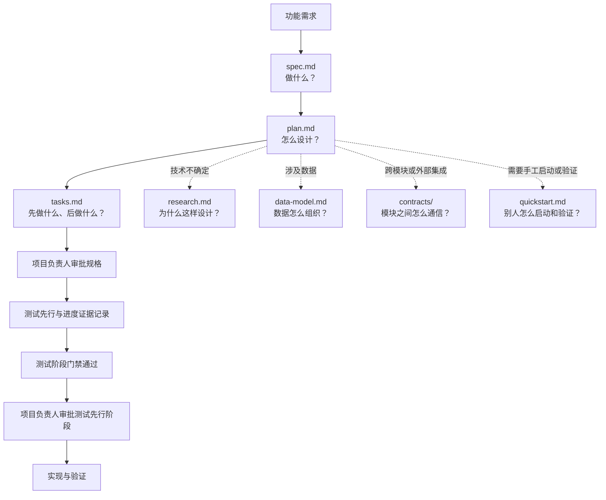

# Export Flow

项目规范、文档基线和协作入口都在 [`AGENTS.md`](AGENTS.md)。模型或贡献者开始工作前，请先阅读该文件。

本仓库采用规格驱动开发方法和中文规格模板。项目原则位于 `.specify/memory/constitution.md`。当前技术决策见 [`docs/adr/`](docs/adr/)，新出现且尚未决定的事项记录在 [`docs/decisions-pending.md`](docs/decisions-pending.md)。

已确认技术栈：React + TypeScript + Vite + Ant Design 前端，Java 21 + Spring Boot 3 + MySQL 8.4 后端，Apache POI 流式生成 Excel；RabbitMQ 承担导出任务队列，MyBatis 负责数据库访问，Flyway 管理迁移。执行恢复及本地工具链见[ADR-0008](docs/adr/0008-worker-execution-lease-and-recovery.md)和[ADR-0009](docs/adr/0009-engineering-runtime-and-progress-notification.md)。Redis进度缓存、完整任务页及SSE后续实施；本期交付静态dist和可执行jar，远程发布延期。

规格流程仅负责开发阶段的需求、计划和任务拆分；构建、测试执行、打包、容器和发布遵循 `docs/rules/` 中的项目规则。中高风险变更使用 `spec.md`、`plan.md`、`tasks.md` 及按需生成的附属产物。

2026-10-07 已按[基础骨架规格](specs/001-project-bootstrap/spec.md)创建前端及职责占位，原验证记录保留。后续订单开发遵循[订单规格](specs/002-order-management/spec.md)及其独立测试先行与授权记录。

## 项目启动

2026-10-11[订单规格0.4](specs/002-order-management/spec.md)已获开发授权。订单页面及集中API已实现，153项前端测试、类型检查和构建通过。2026-10-12删除订单造数，后端直接读取负责人容器中的110000条订单；当前功能回归300项通过，正式质量门禁通过，110000行Excel五次独立测量成功。性能测试已按负责人要求停止，本轮开发与review收尾；剩余验证由负责人确认本轮无需执行，适用验证与免验记录已收尾，不将免验记作实测通过。实际状态见[任务清单](specs/002-order-management/tasks.md)和[来源结果](docs/validation/002-order-management/provided-data.md)。

以下命令均在项目根目录执行，适用于 Windows PowerShell。任务页已提供列表、筛选、SSE、暂停及[继续增量](specs/005-task-resume-and-live-progress/spec.md)。后端不可达时，页面显示可重试的请求错误。

### Make 启动入口

已有容器保持运行。安装Java21、Node22和GNU Make后，复制连接配置并填写真实值：

```powershell
if (-not (Test-Path .env.local)) { Copy-Item .env.example .env.local }
# 填写 .env.local 中的运行、迁移和 MQ 凭据。
make dev
```

前端打开[http://127.0.0.1:5173/orders](http://127.0.0.1:5173/orders)，后端监听127.0.0.1:8080；按Ctrl+C停止应用。也可分别执行`make frontend`和`make backend`，`make build`生成dist与jar，`make help`查看全部入口。脚本固定使用pnpm10.34.6，启动不执行测试或性能专项。

Windows PowerShell也可直接执行`./make dev`，根[make.cmd](make.cmd)会找到本机已安装的GNU Make，无需先刷新当前终端PATH。

导出文件和断点存放在项目根目录的`export-data/`，由`.env.local`中的`EXPORT_FLOW_FILE_ROOT`绝对路径指定，该目录已被Git忽略。完成的Excel位于`export-data/tasks/<任务ID>/artifacts/<文件ID>.xlsx`；修改此配置后需重新启动后端。

应用库export_flow、账号及MQ vhost /export-flow需已准备；容器启动不代表这些应用资源存在。入口只复用已有服务，不创建容器、不造订单数据。Windows Make安装、连接权限和无Make时的命令见[脚本说明](scripts/README.md)，本次核验见[启动入口记录](docs/validation/002-order-management/startup-entry.md)。下方保留直接工具链命令供单独操作。

### 环境要求

- Node.js 22 LTS，至少 22.12；本轮验证版本为 22.14.0。
- pnpm 10，项目锁定版本为 10.34.6。

检查本机版本：

```powershell
node --version
pnpm --version
```

### 启动前端

首次运行或依赖锁文件更新后，先安装依赖，再启动开发服务器：

```powershell
pnpm --dir frontend install --frozen-lockfile
pnpm --dir frontend dev
```

打开 [http://127.0.0.1:5173](http://127.0.0.1:5173)。`/` 自动进入 `/orders`，侧栏可切换到 `/export-tasks`。终端保持运行，按 `Ctrl+C` 停止开发服务器。

若本机 pnpm 不是 10，使用下面的固定版本命令，无需更改全局安装：

```powershell
npm exec --yes --package=pnpm@10.34.6 -- pnpm --dir frontend install --frozen-lockfile
npm exec --yes --package=pnpm@10.34.6 -- pnpm --dir frontend dev
```

### 类型检查、构建与预览

```powershell
pnpm --dir frontend typecheck
pnpm --dir frontend build
pnpm --dir frontend preview
```

构建成功后，打开 [http://127.0.0.1:4173](http://127.0.0.1:4173) 查看生产构建预览；按 `Ctrl+C` 停止预览服务器。若本机 pnpm 版本不一致，同样在上述每条命令前加 `npm exec --yes --package=pnpm@10.34.6 -- `。

开发和预览只监听 `127.0.0.1`；5173 或 4173 被占用时会报告错误，不会自动切换端口。

### 后端启动状态

准备本机独立MySQL schema、RabbitMQ vhost、外部凭据和文件根后，按[quickstart](specs/002-order-management/quickstart.md)运行正式工程：

```powershell
backend/mvnw.cmd -f backend/pom.xml -Dmaven.test.skip=true package
java -jar backend/target/export-flow-0.2.0-SNAPSHOT.jar --export-flow.consumer-enabled=true
```

应用仅绑定127.0.0.1:8080，Vite开发代理指向该地址。Flyway使用独立迁移凭据，运行账号仅能读取订单。订单[直接复用已有数据](specs/002-order-management/provided-data.md)，本项目造数工具及合成SQL已删除，不创建或初始化订单表。上述命令为当前入口，门禁结果以实施进度记录为准。

模块职责详见[前端说明](frontend/README.md)与[后端说明](backend/README.md)；本轮实际命令和页面验证见[验证环境](docs/validation/001-project-bootstrap/environment.md)。

## 使用方式

### 只查看代码或运行已有产物

启动项目先查看本 README 的[项目启动](#项目启动)；模块细节见对应 README。查看代码或参与修改前，阅读 [`AGENTS.md`](AGENTS.md)。

### 参与开发

阅读 [`AGENTS.md`](AGENTS.md)，根据任务查阅对应的项目规则。中高风险功能使用
按“需求规格 → 澄清（可选）→ 技术计划 → 任务拆分”阶段完成文档，具体设计要求见
[规格准备规则](docs/rules/specification.md)。项目负责人批准规格后先准备并运行测试、记录进度与证据，
测试阶段门禁通过并再次获项目负责人明确批准后，才按项目测试、构建和发布规则完成生产实现。

## 项目结构

```text
.
├── AGENTS.md                         # 模型入口、最高级项目规则和文档索引
├── README.md                         # 人类贡献者入口和快速开始说明
├── .specify/                         # 规格模板和开发原则
│   ├── memory/constitution.md        # 开发阶段规则和门禁
│   └── templates/                    # spec/plan/tasks 等标准模板
├── specs/                            # 按需创建的功能规格和任务
├── docs/
│   ├── rules/                        # 前后端、测试、构建、容器等领域细则
│   ├── adr/                          # 架构决策记录
├── scripts/                          # 项目级检查和自动化脚本
├── frontend/                         # 订单管理与静态任务页；统一业务API
└── backend/                          # Spring Boot、MyBatis、Flyway及异步文件链路
```

## 规则权级和文件权限

规则从高到低为：

```text
AGENTS.md
  > .specify/memory/constitution.md
  > docs/rules/
  > specs/<feature-dir>/
  > 实现代码
```

| 内容 | 权限和要求 |
| --- | --- |
| `AGENTS.md` | 项目最高管理规则，修改需要项目负责人评审 |
| `.specify/memory/constitution.md` | 开发流程和门禁，必须遵守 AGENTS.md，修改需要治理评审 |
| `.specify/` 模板和原则 | 项目开发基础设施，不能在普通功能开发中随意修改 |
| `docs/rules/` | 各领域执行细则，由对应领域负责人评审 |
| `specs/` | 按需创建的功能规格、计划和任务，随功能变更提交并评审 |
| `docs/adr/` | 架构决策记录，重大技术选择必须新增或更新 |

上述顺序约束开发治理与工程实现，不允许工程规则改写产品基线或已接受的 ADR。发现冲突时暂停实施，先确认事项归属，再更新其所有者文档并同步下游文档；详见 [`AGENTS.md`](AGENTS.md)。

## 按任务查阅

- 只查看或运行项目：阅读本 README 和 `AGENTS.md`。
- 前端开发：`AGENTS.md` → constitution → `docs/rules/frontend.md` → `docs/rules/testing.md`。
- 后端开发：`AGENTS.md` → constitution → `docs/rules/backend.md` → `docs/rules/testing.md`。
- 中高风险功能：再创建并评审 `specs/<feature-dir>/spec.md`、`plan.md` 和 `tasks.md`。
- 架构、依赖或数据存储变化：增加或更新 `docs/adr/`。
- 构建、打包、容器和发布：读取对应的 `docs/rules/`，这些环节不由规格流程接管。

## 规格产物说明

每个中高风险功能至少包含三个核心文件：

| 文件 | 作用 |
| --- | --- |
| `spec.md` | 说明用户要解决什么问题、功能范围、用户故事和验收标准 |
| `plan.md` | 技术方案、目录树、逐文件职责、前后端与通用函数签名、中文职责注释、简短流程和调用关系 |
| `tasks.md` | 有顺序、可追踪的开发任务、测试进度与证据、规格和测试先行阶段两次审批记录 |

`plan` 阶段会根据功能需要生成附属文件，不是每次都全部生成：

| 产物 | 用途 | 什么时候需要 |
| --- | --- | --- |
| `research.md` | 记录技术调研、方案比较、实验结果和选择理由 | 技术方案不确定，或存在多个候选方案时 |
| `data-model.md` | 记录实体、字段、类型、关系、约束、状态和生命周期 | 涉及数据库、持久化数据或复杂状态时 |
| `contracts/` | 记录 API、事件、消息和模块边界的输入输出格式 | 跨模块、跨服务或对接外部系统时 |
| `quickstart.md` | 记录本功能的本地启动、配置、操作和验证方法 | 需要手工验证、演示或新增运行步骤时 |

判断方式很简单：如果功能没有对应内容，就不需要创建该文件；如果功能涉及对应内容，
就必须生成并填写。所有生成的规格内容必须使用中文，并且最终要能映射到测试和任务。

规格产物流程：



`spec.md`、`plan.md` 和 `tasks.md` 是核心链路；其他文件根据功能实际需要从 `plan.md`
分支生成。没有对应场景时不创建附属文件。
